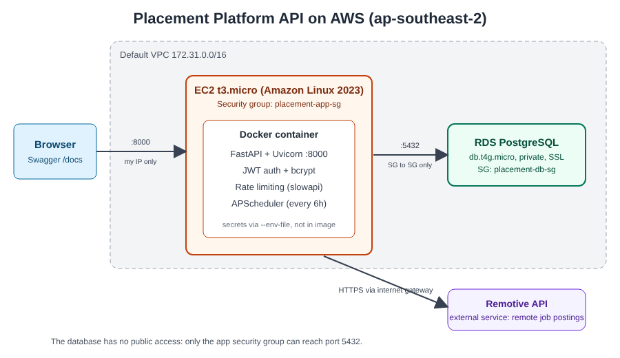

## Deployed on AWS



| Piece | Choice |
|---|---|
| Compute | EC2 t3.micro (Amazon Linux 2023), app runs in a Docker container |
| Database | RDS PostgreSQL (db.t4g.micro), private, SSL required |
| Network | Default VPC; app security group allows port 8000 only from my IP; database security group allows port 5432 only from the app security group |
| Secrets | Environment variables via `--env-file`; nothing is in the image or Git |
| Security | JWT auth, bcrypt password hashing, rate limiting on `/login`, `/signup` and `/pipeline/run-now`, pipeline endpoint requires login |
| Data pipeline | APScheduler pulls remote jobs from the Remotive API every 6 hours |

### Run it yourself
```
cp .env.example .env        # fill in real values; never commit .env
docker build -t placement-api .
docker run -d --name api --env-file .env -p 8000:8000 placement-api
```
Then open `http://<server-ip>:8000/docs`.

### Lessons learned
- Hardcoded secrets in early commits stay in Git history: move them to environment variables and rotate them.
- A private database reachable only from the app's security group is safer than relying on IP allowlists.
- Rate limiting is cheap and blocks password guessing.
